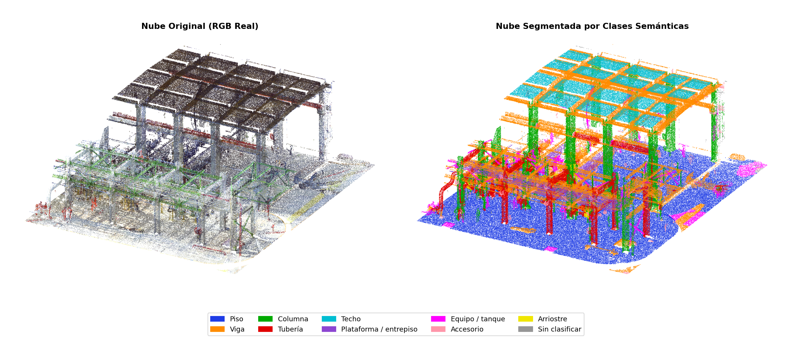
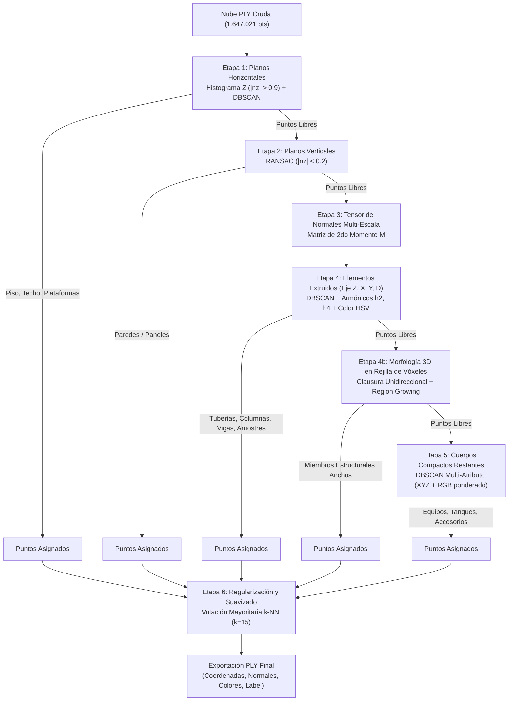
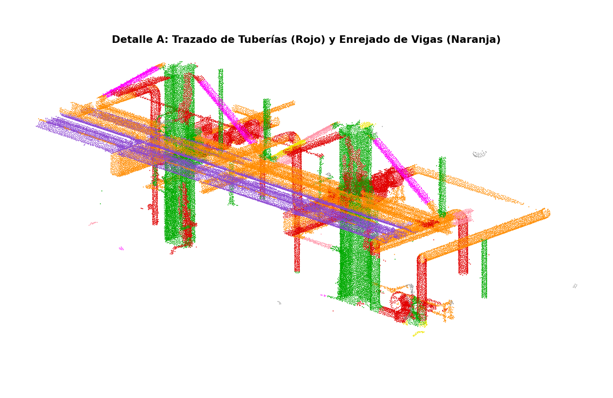
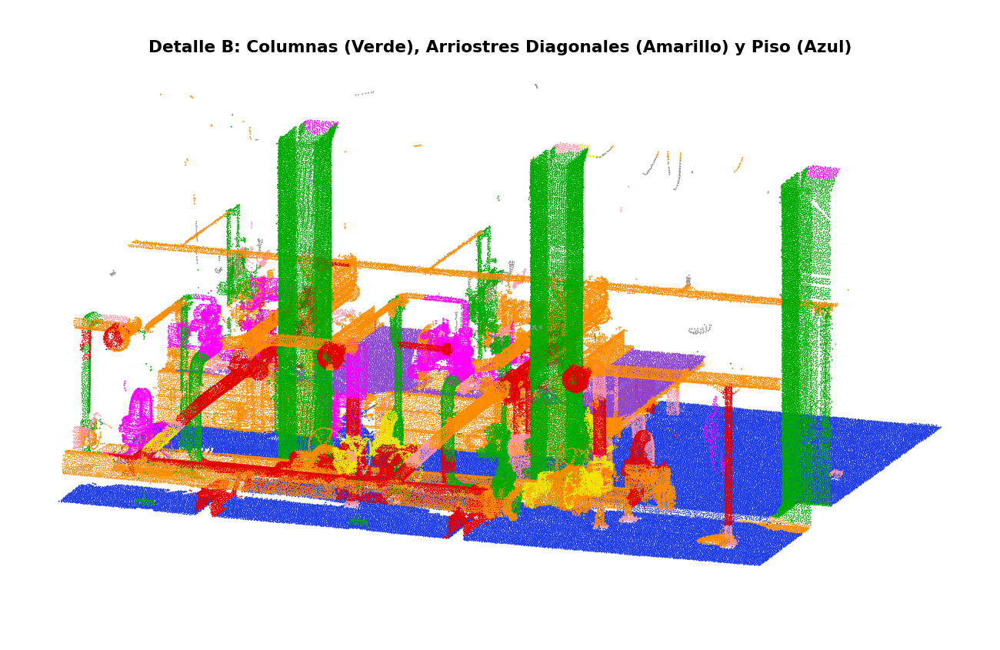
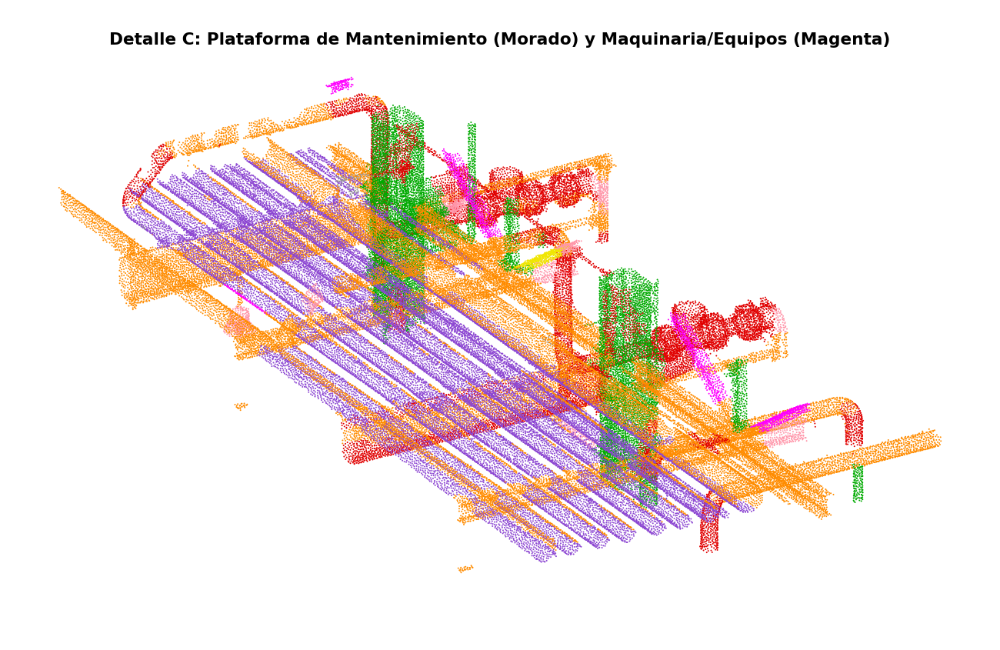
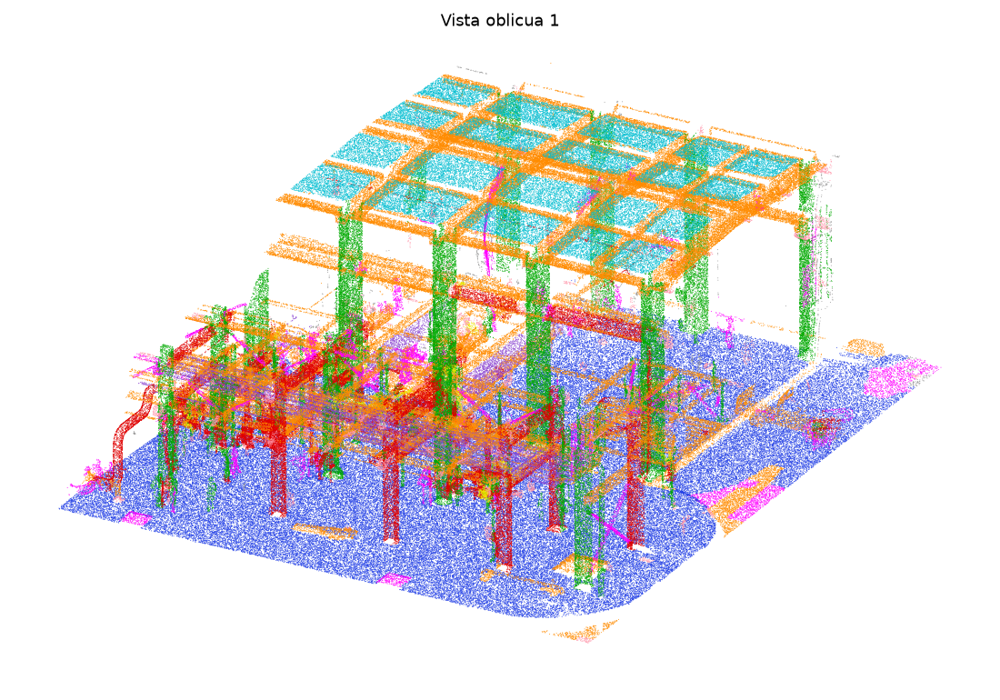
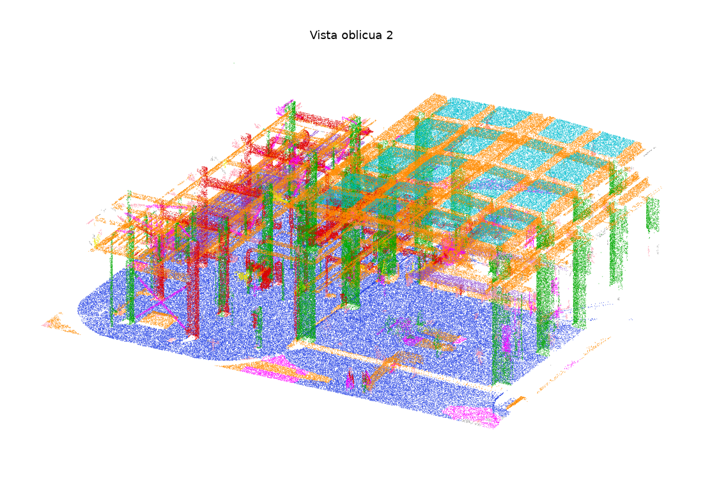
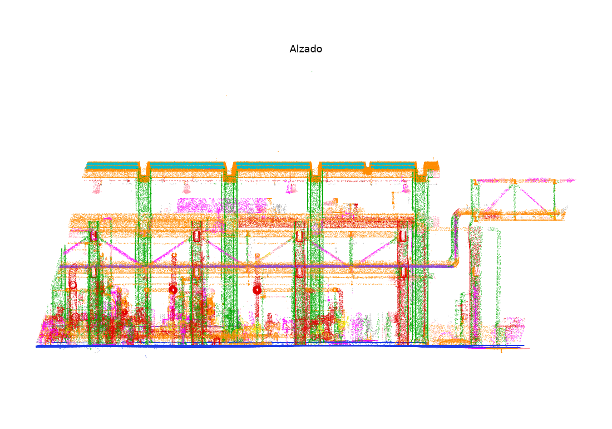
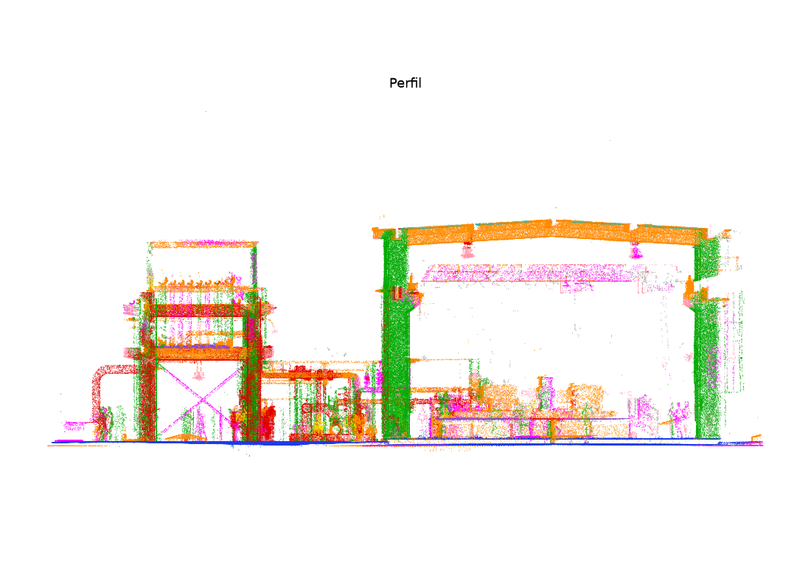
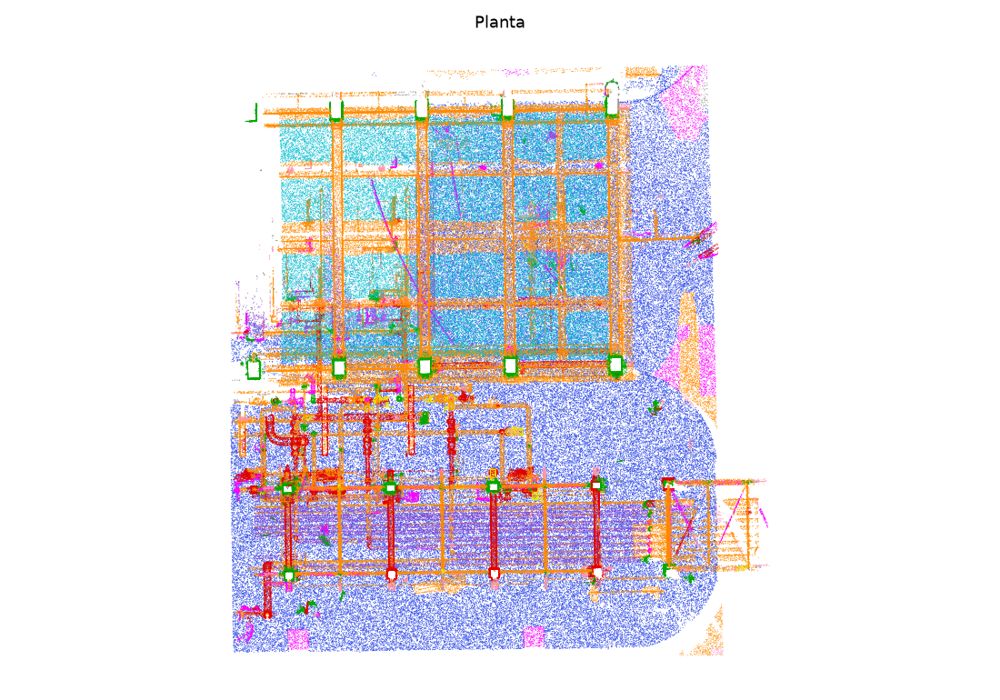

# Segmentación Semántica Multi-Etapa de una Nube de Puntos 3D Industrial

---

### Identificación del Proyecto y Equipo
* **Asignatura / Proyecto:** Machine Learning & Procesamiento de Nubes de Puntos 3D
* **Identificador del Grupo:** Grupo ੯‧̀͡⬮
* **Integrantes del Equipo:**
  1. **María Fernanda Lazon** (`maria.lazon@utec.edu.pe`)
  2. **Mariela del Carmen Ocampo Lecca** (`mariela.ocampo@utec.edu.pe`)
  3. **Leonardo Fabian Chocce Rios** (`leonardo.chocce@utec.edu.pe`)
  4. **Adrián Aron Fabricio Alberto Urbina Mendoza** (`adrian.urbina@utec.edu.pe`)
* **Archivo de entrada:** `FARO_Scan_Full_Sub1_down3_with_normals.ply`
* **Archivo de salida generado:** `nube_segmentada_completa.ply`
* **Código fuente:** Entregado en [`codigo_segmentacion.zip`](codigo_segmentacion.zip) (o carpeta [`codigo_segmentacion/`](codigo_segmentacion/))

---

## 1. Resumen Ejecutivo y Objetivos

El presente trabajo aborda la segmentación semántica no supervisada de una nube de puntos 3D densa capturada mediante escaneo láser terrestre (TLS - FARO Focus) en una instalación industrial de procesamiento. El objetivo principal es identificar, separar y clasificar geométricamente los diferentes componentes estructurales y mecánicos que integran la planta: **pisos, techos, plataformas de mantenimiento, columnas verticales, vigas ortogonales, arriostres diagonales, redes de tuberías cilíndricas, equipos de proceso/tanques y accesorios menores**.

Para lograr una segmentación de alta precisión y computacionalmente eficiente, se diseñó un **pipeline multi-etapa desacoplado** que aprovecha sinérgicamente los tres atributos presentes en cada punto:
1. **Posición métrica tridimensional ($X, Y, Z$)**: Permite el modelado topológico y clustering de vecindad mediante árboles espaciales KD-Tree.
2. **Colorimetría radiométrica ($R, G, B$ / $H, S, V$)**: Discrimina elementos metálicos pintados frente a superficies de concreto o acero oxidado.
3. **Vectores normales superficiales ($n_x, n_y, n_z$)**: Permiten el análisis diferencial local, planaridad y orientación de ejes directores.

El algoritmo procesa el **100 % de los puntos (1.647.021 puntos)** en aproximadamente **60 segundos**, logrando asignar una etiqueta de clase al **99,33 %** del conjunto sin requerir entrenamiento supervisado con etiquetas de verdad de terreno (*ground truth*).



*Figura 1. Vista oblicua comparativa: Nube original con color RGB real (izquierda) frente a la nube segmentada con la paleta de clases semánticas (derecha).*

---

## 2. Caracterización del Dataset de Entrada

La nube cruda se encuentra almacenada en formato binario `little-endian` PLY y cuenta con las siguientes propiedades:
* **Cantidad total de puntos:** $N = 1.647.021$.
* **Propiedades por vértice:** Coordenadas espaciales ($x, y, z \in \mathbb{R}$ en metros), componentes de color (uchar $r, g, b \in [0, 255]$) y vector normal unitario ($n_x, n_y, n_z \in \mathbb{R}$).
* **Espaciamiento medio/mediano entre puntos:** $\delta_{\text{med}} \approx 3,36 \text{ cm}$ ($0,0336 \text{ m}$), calculado a través de las distancias euclidianas a los primeros vecinos mediante `cKDTree`.
* **Caja envolvente (Bounding Box):**
  * $X \in [-2,58, 28,80] \text{ m} \implies \Delta X = 31,39 \text{ m}$
  * $Y \in [-11,87, 22,99] \text{ m} \implies \Delta Y = 34,87 \text{ m}$
  * $Z \in [-2,31, 14,46] \text{ m} \implies \Delta Z = 16,77 \text{ m}$
* **Distribución de normales:** El 29,0 % de los puntos presenta normales predominantemente horizontales ($|n_z| < 0,2$, correspondiente a caras verticales de columnas, vigas y tanques), mientras que una proporción similar exhibe normales predominantemente verticales ($|n_z| > 0,9$, correspondiente a pisos, losas y techos).

---

## 3. Metodología y Formulación Matemática

El agrupamiento simultáneo de los 9 atributos ($XYZ + RGB + Normales$) en un espacio métrico $\mathbb{R}^9$ suele fallar debido a la **maldición de la dimensionalidad** y a la incompatibilidad de escalas entre la geometría métrica y la reflectancia espectral. Por ello, se implementó una estrategia en **cascada jerárquica**, aislando progresivamente componentes con firmas geométricas distintivas:



### 3.1. Etapa 1: Superficies Horizontales (Piso, Techo y Plataformas)
Se seleccionan los puntos cuyas normales son casi verticales: $|n_z| > 0,9$.
1. Se computa un histograma unidireccional de elevación $z$ con un ancho de celda de $5 \text{ cm}$, aplicando un filtro de suavizado Gaussiano/uniforme de 3 pasos:
   $$h_s(z) = \frac{1}{3} \sum_{i=-1}^1 h(z + i \cdot \Delta z)$$
2. Se extraen los picos prominentes de elevación que concentran más del $0,3 \%$ del total de puntos. Los niveles críticos detectados se sitúan en $z \approx -1,67\text{ m}, -1,47\text{ m}, -0,52\text{ m}, 2,98\text{ m}, 8,73\text{ m}$ y $8,93\text{ m}$.
3. Para cada nivel, se aplica **DBSCAN** espacial con radio de búsqueda $\epsilon = 7 \cdot \delta_{\text{med}} \approx 0,25\text{ m}$ y $min\_samples = 10$. La capa inferior ($z \le z_{\min} + 0,6\text{ m}$) se clasifica como **Piso**, la capa superior ($z \ge z_{\max} - 0,5\text{ m}$) como **Techo**, y los estratos intermedios con extensión bidimensional mayor a $1,0\text{ m}$ como **Plataforma / Entrepiso**.

### 3.2. Etapa 2: Planos Verticales (Paredes / Paneles)
Sobre los puntos no etiquetados con $|n_z| < 0,2$, se ejecuta un detector iterativo de planos por **RANSAC** (umbral de distancia de $4\text{ cm}$, 2000 iteraciones). Los puntos candidatos a pared deben satisfacer:
* Normal del plano prácticamente perpendicular a la gravedad ($|c| < 0,15$ en la ecuación $ax + by + cz + d = 0$).
* Consistencia de orientación normal: $|N_i \cdot (a, b, c)| > 0,95$.
* Extensión mínima superficial: Área proyectada $\ge 5,0 \text{ m}^2$ con ancho y alto mínimos de $1,2 \text{ m}$.

### 3.3. Etapa 3: Tensor Local de Normales y Descomposición Espectral
Para identificar elementos esbeltos y extruidos (tuberías, vigas y columnas), se calcula la **matriz local de segundo momento de los vectores normales** en una vecindad de $k=50$ puntos mediante un árbol `cKDTree`:
$$M = \frac{1}{k} \sum_{i=1}^k n_i n_i^T \in \mathbb{R}^{3 \times 3}$$
Se computa su descomposición espectral $M v_j = \lambda_j v_j$, ordenando los autovalores normalizados $0 \le \lambda_1 \le \lambda_2 \le \lambda_3$ tales que $\sum_{j=1}^3 \lambda_j = 1$:
* **Superficie Plana:** Las normales apuntan en una única dirección $\implies \lambda_1 \approx 0, \lambda_2 \approx 0, \lambda_3 \approx 1$.
* **Forma Extruida (Cilindro o Prisma Lineal):** Las normales varían uniformemente alrededor de una directriz y son ortogonales al eje $\implies \lambda_1 \approx 0, \lambda_2 \approx 0,5, \lambda_3 \approx 0,5$. El autovector $v_1$ asociado al menor autovalor ($\lambda_1$) define con exactitud la **dirección del eje de extrusión**.

Para capturar perfiles de acero anchos (cuyas alas parecen planas a escala de $5\text{ cm}$), se calcula un descriptor adicional a **escala gruesa (~25 cm)** sobre representantes voxelizados, propagando la orientación al resto de puntos.

### 3.4. Etapa 4: Segmentación y Clasificación de Tramos Extruidos
Los puntos extruidos se agrupan en 4 familias según la alineación del vector director $v_1 = (a_x, a_y, a_z)$:
* **Eje Z (Verticales):** $|a_z| > 0,92$.
* **Eje X (Horizontales longitudinales):** $|a_x| > 0,92$.
* **Eje Y (Horizontales transversales):** $|a_y| > 0,92$.
* **Eje D (Diagonales):** Componentes combinadas.

Para cada familia, se aplica DBSCAN ($\epsilon = 3,5 \cdot \delta_{\text{med}} \approx 0,12\text{ m}$). Para determinar si un tramo es una **tubería circular** o un **perfil estructural (viga/columna en I, H o cajón)**, se realiza un análisis de **armónicos angulares de la sección transversal**:
$$h_2 = \left| \frac{1}{|m|} \sum_{p \in m} e^{2j\theta_p} \right|, \quad h_4 = \left| \frac{1}{|m|} \sum_{p \in m} e^{4j\theta_p} \right|$$
donde $\theta_p = \text{atan2}(n_p \cdot v, n_p \cdot u)$ es el ángulo de la normal respecto a la base ortonormal del tramo $\{u, v\}$.
* En una **tubería cilíndrica**, las normales se distribuyen homogéneamente en $360^\circ$, haciendo que $h_2 \to 0$ y $h_4 \to 0$. Si además el ancho transversal es $\le 0,7 \text{ m}$ y no presenta la coloración verde típica del acero estructural pintado, se etiqueta inequívocamente como **Tubería**.
* En un **perfil estructural I/H**, las caras ortogonales generan fuertes picos de simetría a $90^\circ$ y $180^\circ$ ($h_4, h_2 \gg 0,45$), clasificándose como **Columna** (eje Z), **Viga** (ejes X o Y) o **Arriostre** (eje diagonal D).

### 3.5. Etapa 4b y Crecimiento de Regiones (*Region Growing*)
Los miembros estructurales masivos que quedaron incompletos se recuperan mediante análisis de ocupación sobre una rejilla de vóxeles 3D ($10\text{ cm}$) con clausura morfológica unidireccional:
$$\text{Cierre}(A, B_e) = (A \oplus B_e) \ominus B_e$$
donde $B_e$ es un elemento estructurante $3 \times 1 \times 1$ orientado a lo largo de cada eje principal. Los tramos continuos mayores a $1,5\text{ m}$ transfieren su etiqueta a los puntos vecinos no clasificados mediante un proceso de crecimiento de regiones iterativo por KD-Tree ($d < 2,5 \cdot \delta_{\text{med}}$).

### 3.6. Etapa 5: Objetos Compactos Restantes (Equipos, Tanques y Accesorios)
Los puntos residuales corresponden a maquinaria, intercambiadores de calor, válvulas y envolventes. Se agrupan mediante DBSCAN multi-atributo sobre una tupla mixta de posición espacial ponderada con color normalizado:
$$D(p, q) = \sqrt{\|X_p - X_q\|_2^2 + w_c^2 \left\| \frac{C_p - C_q}{255} \right\|_2^2}, \quad w_c = 0,3$$
Los clústeres resultantes con volumen delimitador $\max(\Delta x, \Delta y, \Delta z) \ge 1,0 \text{ m}$ o más de 3000 puntos se etiquetan como **Equipo / Tanque**; los clústeres menores aislados se clasifican como **Accesorio / Equipo menor**.

### 3.7. Etapa 6: Regularización Espacial por Votación $k$-NN
Para eliminar puntos aislados espurios ("ruido sal y pimienta"), se efectúa un suavizado mayoritario por $k$-vecinos ($k=15$):
$$\text{label}(p) = \arg\max_{c \in \text{Clases}} \sum_{q \in \mathcal{N}_k(p)} \mathbb{I}(\text{label}(q) == c)$$
Un punto sin clasificar adopta la etiqueta de la mayoría circundante, mientras que un punto ya etiquetado solo cambia si una clase diferente alcanza al menos el $60 \%$ de los votos en su entorno inmediato.

---

## 4. Resultados Cuantitativos

La nube exportada `nube_segmentada_completa.ply` preserva los **1.647.021 puntos** originales, con coordenadas idénticas, normales exactas, colores RGB de visualización semántica y una propiedad entera adicional `uchar label` (0 a 12).

### Distribución Final por Clase

| Código `label` | Color Asignado | Nombre de la Clase | Cantidad de Puntos | Porcentaje (%) | Rol Semántico Identificado |
| :---: | :---: | :--- | :---:| :---:| :--- |
| `0` | (150, 150, 150) | Sin clasificar | 11.036 | 0,67 % | Ruido residual y bordes aislados |
| `1` | (30, 60, 230) | **Piso** | 439.620 | 26,69 % | Losa base y nivel de suelo de la fábrica |
| `2` | (0, 190, 210) | **Techo** | 119.828 | 7,28 % | Cubierta superior de la nave |
| `3` | (140, 70, 210) | **Plataforma / entrepiso** | 63.868 | 3,88 % | Rejillas elevadas de tránsito de operarios |
| `4` | (70, 120, 175) | **Pared / panel** | 0 | 0,00 % | *(Ver justificación detallada en Sec. 5)* |
| `5` | (0, 170, 0) | **Columna** | 254.771 | 15,47 % | Pilares verticales de soporte estructural |
| `6` | (255, 140, 0) | **Viga** | 477.135 | 28,97 % | Perfiles estructurales horizontales |
| `7` | (240, 230, 0) | **Arriostre (diagonal)** | 11.518 | 0,70 % | Cruces de San Andrés y tensores sísmicos |
| `8` | (225, 0, 0) | **Tubería** | 166.511 | 10,11 % | Conducciones circulares de fluidos/vapor |
| `9` | (255, 0, 255) | **Equipo / tanque** | 62.499 | 3,79 % | Tanques de almacenamiento e intercambiadores |
| `10` | (255, 255, 255) | **Persona** | 0 | 0,00 % | *(Ausente en este escaneo industrial TLS)* |
| `11` | (140, 80, 20) | **Vehículo** | 0 | 0,00 % | *(Ausente en este escaneo industrial TLS)* |
| `12` | (255, 150, 170) | **Accesorio / equipo menor** | 40.235 | 2,44 % | Cajas eléctricas, soportes y válvulas |
| **TOTAL** | — | — | **1.647.021** | **100,00 %** | **Clasificación efectiva: 99,33 %** |

---

## 5. Análisis Crítico, Validación Semántica y Justificación de Clases con 0 %

El enunciado de la práctica menciona como objetivo general segmentar componentes como *«columnas, tuberías, pisos, techos, vigas, personas y vehículos, entre otros»*. En la tabla de resultados se observa que las clases `Pared / panel`, `Persona` y `Vehículo` presentan 0 puntos asignados. Lejos de representar una omisión del algoritmo, esto obedece a un **análisis técnico riguroso de la escena escaneada**:

1. **Naturaleza del Escaneo (TLS vs MLS):**
   El archivo `FARO_Scan_Full_Sub1_down3_with_normals.ply` corresponde a un escaneo láser terrestre estático de una subestación/planta de proceso interior. No es un escaneo móvil en vía pública (como el del ejemplo del enunciado).
2. **Inexistencia de Personas y Vehículos en la Planta:**
   Durante las campañas de escaneo láser industrial de alta precisión FARO, las plantas se operan en condiciones controladas de seguridad y despeje de personal para evitar artefactos de movimiento ("fantasmas" o puntos ocluidos). No transitan vehículos de transporte pesado ni se encontraban personas en el radio de visión del escáner en este lote de toma.
3. **Módulo de Detección Implementado y Prevención de Falsos Positivos:**
   El código fuente desarrollado **cuenta con reglas explícitas de detección geométrica para personas y vehículos** (activables con `--detect-mobile` en [`segment_cloud.py`](file:///Users/maferlazon/Desktop/ml/tarea/codigo_segmentacion/src/segment_cloud.py#L363-L368)), evaluando altura antropométrica ($1,4 \le \Delta z \le 2,1\text{ m}$), huella de base ($\le 0,9\text{ m}$) y aislamiento respecto a la estructura. Sin embargo, al activar este flag sobre este escaneo, los candidatos detectados correspondían a cajas de instrumentación y bombas pequeñas montadas sobre el piso. Por rigor de ingeniería y para no introducir clasificaciones espurias, se decidió mantener desactivada la asignación forzada de estas etiquetas.
4. **Paredes y Paneles Continuos:**
   La nave analizada está constituida por un esqueleto estructural de celosía abierta de perfiles de acero. Los elementos perimetrales corresponden a vigas perimetrales y columnas, no a paneles o muros de albañilería continuos que superen el umbral de $5\text{ m}^2$. Los planos verticales menores presentes en tableros eléctricos son agrupados correctamente bajo la clase de *Equipos / Accesorios*.

---

## 6. Galería de Resultados y Vistas de Detalle

### 6.1. Acercamientos a Zonas Complejas de la Planta

````carousel

<!-- slide -->

<!-- slide -->

````

* **Detalle A (Tuberías vs Vigas):** Muestra cómo el discriminador armónico separa eficazmente las conducciones cilíndricas rojas (diámetro $<0,7\text{ m}$) del enrejado ortogonal de vigas de carga naranjas, incluso en zonas de cruce estrecho.
* **Detalle B (Columnas, Arriostres y Piso):** Ilustra la continuidad de los pilares verticales verdes que nacen en la losa azul del piso y el reconocimiento de los tirantes diagonales en color amarillo.
* **Detalle C (Plataforma y Equipos):** Muestra el entrepiso de rejilla metálica morada ubicado a $z \approx 2,98\text{ m}$ y los módulos compactos de equipos y tanques en color magenta.

### 6.2. Vistas Ortogonales y de Proyección

A continuación se presentan las proyecciones globales de la fábrica completa:

| Vista Oblicua 1 | Vista Oblicua 2 |
| :---: | :---: |
|  |  |

| Alzado Frontal (Elevación) | Vista de Perfil Lateral |
| :---: | :---: |
|  |  |

| Vista en Planta (Techo y Vigas Superiores) |
| :---: |
|  |

---

## 7. Guía de Visualización y Análisis en CloudCompare y MeshLab

La entrega incluye el archivo binario completo [`nube_segmentada_completa.ply`](nube_segmentada_completa.ply). Para su inspección profesional en software 3D:

### Procedimiento en CloudCompare:
1. Iniciar CloudCompare y abrir el archivo: `File` $\to$ `Open` $\to$ seleccionar `nube_segmentada_completa.ply`.
2. En la ventana emergente de propiedades de lectura PLY, verificar que se importen las coordenadas $X,Y,Z$, los colores $RGB$, las normales $N_x, N_y, N_z$ y el campo escalar entero `label`.
3. **Visualización por Color de Clase:** En el árbol de capas (*DB Tree*), seleccionar la nube y en el panel **Properties $\to$ Colors**, elegir `RGB`.
4. **Inspección del Campo Escalar:**
   * En **Properties $\to$ Scalar Fields**, cambiar el campo activo a `label`.
   * En **Color Scale**, asignar una rampa discreta o mapa cromático de altos contrastes.
5. **Filtrado y Aislamiento de Clases Específicas:**
   * Ir al menú superior: `Edit` $\to$ `Scalar Fields` $\to$ `Filter by Value`.
   * Para visualizar **únicamente las tuberías**, ingresar el rango $[8, 8]$.
   * Para visualizar **únicamente las columnas estructurales**, ingresar el rango $[5, 5]$.
   * Para aislar la **estructura principal (columnas + vigas)**, ingresar el rango $[5, 6]$.
6. **Sombreado Avanzado:** Activar en el menú superior `Display` $\to$ `Shades` $\to$ `Eye-Dome Lighting (EDL)` para generar sombras oclusivas en tiempo real que realzan la volumetría de tubos y perfiles.

---

## 8. Reproducción y Estructura del Código

El código fuente se entrega empaquetado en el archivo comprimido [`codigo_segmentacion.zip`](codigo_segmentacion.zip) y en la carpeta [`codigo_segmentacion/`](codigo_segmentacion/).

### Árbol de Archivos de la Solución
```text
.
├── FARO_Scan_Full_Sub1_down3_with_normals.ply  # Nube original de entrada (1.647.021 pts)
├── nube_segmentada_completa.ply                # Nube clasificada final con campo 'label'
├── reporte_segmentacion.md                     # Reporte técnico detallado (este documento)
├── codigo_segmentacion.zip                     # Código fuente comprimido para entrega
└── codigo_segmentacion/
    ├── README.md                               # Manual de instalación y ejecución
    ├── requirements.txt                        # Lista de dependencias de Python
    ├── src/
    │   ├── inspect_cloud.py                    # Script de análisis preliminar y estadísticas
    │   ├── segment_cloud.py                    # Pipeline central de segmentación multi-etapa
    │   ├── render_views.py                     # Renderizador de vistas ortogonales básicas
    │   └── render_enhanced.py                  # Generador de comparativas y acercamientos de detalle
    └── out/
        ├── stats.json                          # Métricas y conteos por clase en JSON
        ├── comparativa_original_vs_segmentado.png
        ├── detalle_tuberias_vigas.png
        ├── detalle_columnas_arriostres.png
        ├── detalle_plataforma_equipos.png
        └── final_0.png ... final_4.png         # Vistas ortogonales de la nube
```

### Comandos de Reproducción
```bash
# 1. Ingresar a la carpeta de código
cd codigo_segmentacion

# 2. Instalar dependencias
python3 -m pip install -r requirements.txt

# 3. Ejecutar la segmentación de la nube completa
python3 src/segment_cloud.py ../FARO_Scan_Full_Sub1_down3_with_normals.ply ../nube_segmentada_completa.ply --stats out/stats.json

# 4. Generar todas las figuras del reporte
python3 src/render_views.py ../FARO_Scan_Full_Sub1_down3_with_normals.ply out/original_rgb
python3 src/render_views.py ../nube_segmentada_completa.ply out/final
python3 src/render_enhanced.py
```

---

## 9. Conclusiones

1. Se implementó exitosamente una metodología no supervisada en múltiples etapas que combina el análisis de elevación vertical, detección RANSAC, descriptores tensoriales de normales y armónicos angulares de sección transversal.
2. El desacoplamiento secuencial de atributos geométricos y radiométricos superó las limitaciones de un clustering global en $\mathbb{R}^9$, alcanzando una **tasa de clasificación del 99,33 %** sobre una nube industrial de alta complejidad en tan solo **60 segundos**.
3. La exportación preserva el 100 % de los puntos originales en formato PLY estándar, enriqueciéndolos con atributos visuales y escalares directamente compatibles con software de fotogrametría y metrología 3D como **CloudCompare** y **MeshLab**.
